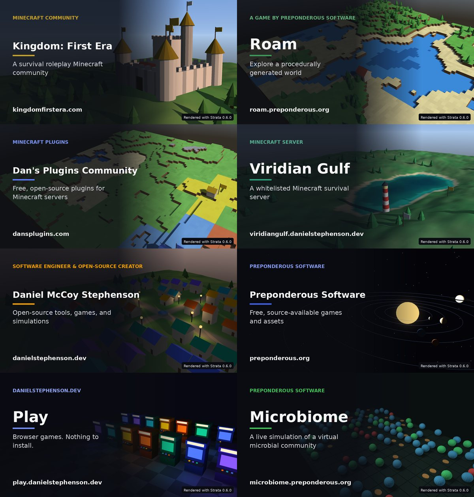

# og-card: link-preview cards rendered with Strata

`og_card.py` draws a site's link-preview image (`og:image`, `twitter:image`): a 1200×630 PNG of a small 3D scene rendered by [Strata](https://github.com/Preponderous-Software/strata), with the site's title, wordmark and address set over it. It replaces the text-only cards with a picture that fits each site, such as a castle for a medieval community, a blocky island for a world-exploring game, or planets on their orbits.



The cards are **pre-rendered**. A site runs this tool once and commits the PNG, so no 3D code, WebAssembly or extra request reaches its pages. A new card is a real change to a site, so it ships through the site's normal release.

This tool is not part of the npm package (`files` in `package.json` lists only `dist`, `README.md` and `LICENSE`). It needs Python, not Node.

## Run it

Linux x86-64, Python 3.8 or later:

```sh
python3 -m venv .venv
.venv/bin/pip install -r tools/og-card/requirements.txt
sudo apt-get install libegl1 libgl1-mesa-dri fonts-dejavu-core   # headless GL and the card's font
.venv/bin/python tools/og-card/og_card.py path/to/og-card.json
```

The tool sets `LIBGL_ALWAYS_SOFTWARE=1` and `GALLIUM_DRIVER=llvmpipe` unless they are already set, so it needs no GPU and no display. A card takes about two seconds.

On its first run the tool downloads the Strata release named in [`strata.lock.json`](strata.lock.json) into `~/.cache/strata/`. It checks the file against the pinned SHA-256 and deletes it on a mismatch, so an unverified library is never loaded. To use a local build instead, pass `--strata path/to/libstrata.so` or set `STRATA_LIBRARY`.

`--check` renders the card again and exits 1 if the committed PNG differs.

## The card spec

A site keeps one JSON file per card, next to whatever it documents. Paths in it are relative to the file.

```json
{
  "output": "../public/og-image.png",
  "scene": "castle",
  "seed": 7,
  "sun": { "azimuth": 100, "elevation": 16 },
  "wordmark": "Minecraft community",
  "title": "Kingdom: First Era",
  "subtitle": "A medieval Minecraft community",
  "url": "kingdomfirstera.com",
  "accent": "#c9a227",
  "alt": "A stone castle with gold-roofed towers and banners on a green hill, with the title Kingdom: First Era."
}
```

| Key | Required | Meaning |
|---|---|---|
| `output` | yes | Where the PNG is written. |
| `scene` | yes | One of the scenes below. |
| `title` | yes | The large line. It shrinks to fit the left column. |
| `url` | yes | The address shown at the bottom left. |
| `alt` | yes | A description of the picture, 20 to 420 characters. The site emits it as `og:image:alt` and `twitter:image:alt`. Update it whenever the scene or text changes. |
| `seed` | no (1) | Picks the scene's layout. The same seed always gives the same scene. |
| `sun` | no | A fixed sun: `azimuth` in degrees (0 = +Z, 90 = +X) and `elevation` in degrees above the horizon (−10 to 90). Used by the outdoor scenes. Below about 8° the village lights its lamps. |
| `wordmark` | no | A small upper-case line above the title, in the accent colour. |
| `subtitle` | no | Up to two lines under the title. |
| `accent` | no | `#rrggbb`. Used for the rule under the title and the wordmark, and by the scenes for banners and roofs. |
| `palette` | no | A list of `#rrggbb` colours, used by `village` (roofs) and `arcade` (cabinets). |
| `logo` | no | A small image drawn before the wordmark. |
| `credit` | no | The credit line's text, followed by the Strata version. Default "Rendered with Strata". |
| `colors` | no | 2 to 256: save a palette PNG with at most this many colours (median cut, dithered). It is about a third of the size, for hosts that cap the card's bytes. |

Next to the spec, the tool writes `<spec name>.provenance.json`. It records the tool commit, the Strata release and the library's SHA-256, the Pillow version and font hashes, the spec, and the PNG's SHA-256.

## Scenes

Every scene is built from the seed alone. None of them reads a clock, a network or any site data, so a card can never show anything private.

| Scene | Picture |
|---|---|
| `arcade` | Arcade cabinets on a checkered floor at night, each screen glowing in a `palette` colour. |
| `castle` | A walled stone castle with towers and banners on a green hill. |
| `claims` | A blocky world divided into tinted 8×8 faction claims with outlined borders, banners and houses. The factions are invented. |
| `coast` | Green headlands around a bay of viridian water, with a lighthouse and banners. |
| `microbiome` | Microorganisms on a grid: alive, foraging and low-energy cells and biomatter, in the Microbiome simulation's four colours. |
| `orbit` | A star lighting its planets, with their orbits traced and a field of stars. |
| `terrain` | A blocky island of grass, sand, rock and water, with trees and a cottage. |
| `village` | Houses around a crossroads and a well, with roofs in `palette` colours and lamps that light at dusk. |

## Determinism

The same spec gives the same bytes, given four things: the pinned Strata release, the pinned Pillow, the same DejaVu font files and the same Mesa llvmpipe. Two runs on one machine, under Python 3.8 and 3.11, wrote identical PNGs. A different Mesa version can move pixels slightly, so the provenance file records the GPU string and font hashes. `--check` shows whether a machine reproduces a committed card.

## Accessibility

The text sits on a dark scrim. The scrim is solid under the whole text column (the left half of the card) and fades out by 78%. Even over a pure white scene, the white and grey text on it keeps a contrast of at least 4.5:1, and the wordmark's accent is lightened until it does too. A test checks both. The card is still an image, so every site must emit its `alt` as `og:image:alt`.

## Tests

```sh
cd tools/og-card
python3 -m unittest -v
```

The spec, scene and layout tests need only Python and Pillow. The render tests need the binding, libEGL and Mesa. They skip when these are missing unless `OG_CARD_REQUIRE_RENDER=1` is set; CI sets it, so in CI a missing renderer fails the run.

## Credit

Scenes are rendered by [Strata](https://github.com/Preponderous-Software/strata) through its official Python binding, `strata-engine`. Text is drawn with Pillow in DejaVu Sans.
